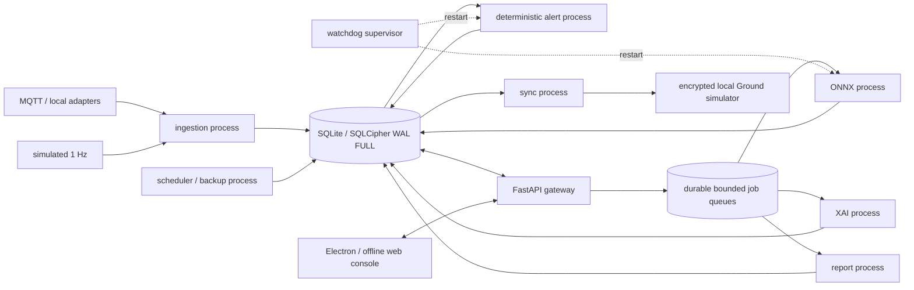

# Kiến trúc

Worker không phụ thuộc API khi chạy độc lập. Alert đọc chỉ số đã commit trong SQLite; không cần AI, Ground hay MQTT còn kết nối. Thời gian phản ứng còn phụ thuộc poll 100 ms, writer contention và tải đĩa, chưa phải bảo đảm hard realtime.

Hàng đợi lưu payload và kết quả trong DB. Khi worker khởi động lại, các job running được đặt pending; inference dùng job UUID làm khóa để tránh tạo hai inference khi replay. Task timeout trả 503 và giữ job; không bịa kết quả.

File waveform dùng tên UUID do hệ thống tạo, không nhận đường dẫn từ client. Ghi file tạm/fsync/rename trước khi lưu con trỏ DB. Nếu DB commit lỗi, có thể còn file mồ côi để phục hồi, chưa tự xóa. Operational bọc file bằng AES-GCM trước khi ghi ra đĩa; DuckDB đọc Arrow đã giải mã trong RAM để không tạo bản plaintext tạm.
