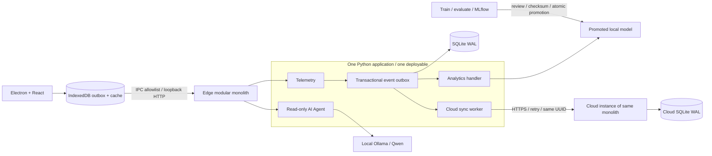

# Hybrid Edge–Cloud + Event-Driven Modular Monolith + AI Agent

## Ranh giới
- **Modular monolith:** `backend/app/modules` chứa telemetry, analytics, agent, event_bus. Một app FastAPI, một image, một worker nền; không tạo API/network riêng cho mỗi module.
- **Hybrid:** Edge và Cloud chạy cùng codebase với `NODE_ROLE` khác nhau; DB riêng. Cloud là nơi tổng hợp bản ghi, không nằm trên đường ghi dữ liệu bắt buộc của Edge.
- **Event-driven:** telemetry commit reading + `health.reading.recorded.v1` trong một transaction. Handler analytics đọc sự kiện, commit assessment + processed cùng transaction. Polling 2 giây là chủ đích của template, không cần Kafka/RabbitMQ.
- **AI Agent:** adapter Qwen tại Edge, chỉ đọc và giải thích. Không có quyền chạy shell, ghi dữ liệu sức khỏe hoặc điều khiển thiết bị. Một yêu cầu sinh nội dung mỗi lần; timeout và fallback độc lập với ingest.
- **AI lifecycle:** training là tác vụ batch ngoài runtime, không phải một microservice. MLflow/Ollama là hạ tầng phụ trợ.

## Hợp đồng dữ liệu
`POST /api/readings`: UUID id, astronaut_id giả danh, observed_at có timezone, heart_rate (bpm), temperature (°C), sleep_hours trong 24h, mood 1–5. Các giới hạn số là kiểm tra kiểu/phạm vi nhập liệu, **không phải ngưỡng cảnh báo lâm sàng**.
`POST /api/events`: schema_version=1, type=health.reading.recorded.v1, reading như trên. Cloud chỉ ACK sau commit. Cùng UUID/cùng nội dung trả duplicate=true; cùng UUID/khác nội dung trả 409.

## Hợp nhất và thứ tự
Bản ghi bất biến, append-only; Edge sở hữu ID gốc. Không last-write-wins, không sửa đè. Một sửa sai là bản ghi mới (template chưa có workflow liên kết correction). Xử lý dựa trên observed_at; không đảm bảo thứ tự xuyên thiết bị. Đồng bộ hiện tại **một chiều Edge → Cloud**; chưa có tải cấu hình hoặc kết quả bác sĩ xuống Edge.

## Quy mô và trust boundary
Một worker Uvicorn cho mỗi node, một ổ đĩa cục bộ; không dùng SQLite trên NFS và không scale ngang cùng volume. Khi tải tăng, giữ ranh giới module rồi thay persistence bằng Postgres + claim/lease cho worker. Cloud cần TLS/reverse proxy, tài khoản theo crew/role và audit trước triển khai thật. Token chia sẻ trong template chỉ dành cho demo một nhiệm vụ, không phải multi-tenant production.
